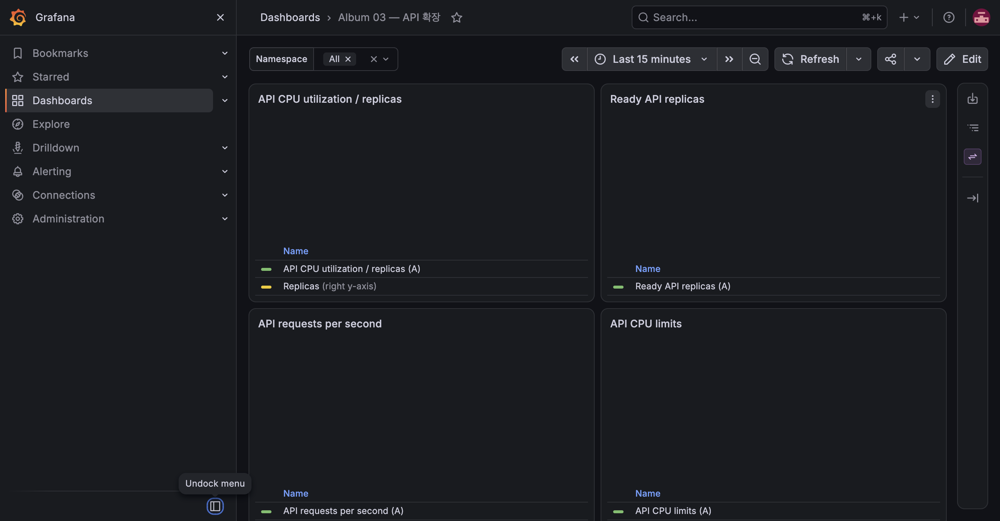

# E-01 API Pod 자동 복구

| 항목 | 내용 |
|---|---|
| 수행 일시 | 2026-10-15 09:11:55~09:13 KST |
| 환경 / 버전 | dev 단일 노드, dev-m3b |
| 판정 | 통과 |

## 기대와 수행

Pod 하나를 지워 Deployment의 자기 복구와 서비스 연속성을 확인한다.
API는 시작 시 3개였고 HPA 최소값을 임시 2로 유지했다. 전체 label 집합을
삭제하지 않고 Pod 하나만 골라 삭제했다.

```bash
uv run --python 3.13 scripts/observe-requests.py --duration 90
kubectl -n album-dev delete pod <API_POD_ONE> --wait=false
kubectl -n album-dev rollout status deployment/api --timeout=120s
```

## 관찰

09:11:55 삭제 후 09:11:59에 대체 Pod가 Ready였다(약 4초).
90초 관측에서 354건 모두 HTTP 200, 실패 0건이었다.



## 정리와 한계

HPA 최소값은 E-04 종료 후 1로 복원했다. 한 replica만 있는 상황에서의
무중단을 주장하지 않는다. 직접 Pod 삭제는 PDB를 우회하므로 이 실험은
PDB의 eviction 보호 검증이 아니다.
