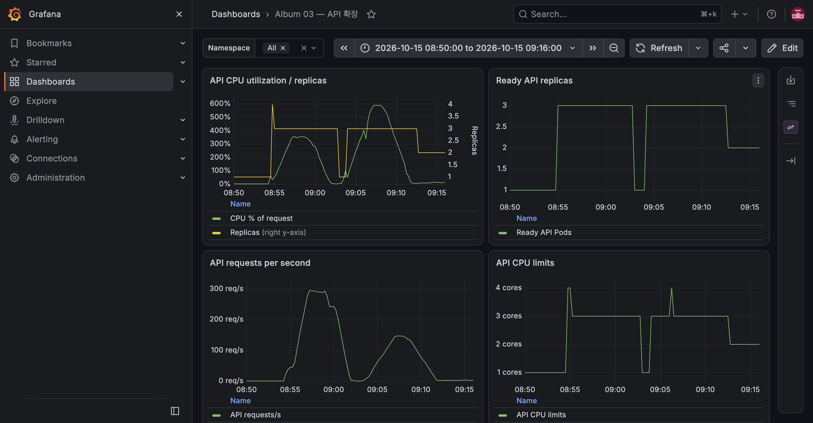

# E-02 CPU 기반 HPA

| 항목 | 내용 |
|---|---|
| 수행 일시 | 2026-10-15 08:54~09:07 KST, 축소 관찰 계속 |
| 환경 | dev, K3S 단일 B4as_v2 노드 |
| 앱 버전 | dev-m3b |
| 판정 | 통과 |

## 목적과 기대

API CPU가 requests의 60%를 넘으면 1→3으로 확장하고, 부하 종료 후
300초 안정화 창을 지나 1개로 돌아온다. CPU limit은 Pod당 1 CPU다.

## 수행

처음에는 200 VU를 즉시 투입했고 업로드와 ConfigMap 변경도 겹쳤다.
89,599건 중 1,125건이 실패(1.25%)해 1% 기준을 넘었다. 이 실패를
삭제하거나 성공으로 취급하지 않았다. 후속 실행은 업로드를 분리하고,
500장 DONE 데이터가 있는 상태에서 30초 ramp-up → 200 VU 3분 →
10초 ramp-down으로 진행했다.

```bash
k6 run --summary-export=/tmp/album-e02-ramp-summary.json loadtest/list.js
kubectl -n album-dev get hpa
kubectl -n album-dev get deployment api
```

## 관찰

첫 실행 08:54:37 CPU 999%에서 API가 1→3으로 확장됐다.
부하 종료와 추가 요청이 멈춘 뒤 09:02:53에 1개로 돌아왔다.
두 번째 실행은 09:03경 1개에서 시작했고 09:04:20에 CPU 899%, 3개였다.

```text
checks_total: 41809
checks_succeeded: 100.00% (41809/41809)
http_req_failed: 0.00%
http_req_duration: avg 959.89ms, p95 2.83s, max 4s
```



CPU Credits Remaining은 첫 부하 직전 259.04였다(08:52 KST 표본).
종료 부근 09:14 표본은 265.48로 고갈되지 않았다. E-01/E-04 동안 최소
replica를 임시 2로 유지했고 09:15:52에 HPA 최소값 1로 복원했다.

## 한계와 정리

requests 대비 CPU %이므로 100%는 노드 전체 사용률이 아니다.
PRD는 HPA 동작 실험이며 이 결과는 처리량 벤치마크가 아니다.
두 번째 실행 중 작은 캐시 기반 이미지 빌드와 격리 cleanup 검증이 잠시
겹쳤으므로 CPU 수치를 독립적인 성능 기준으로 일반화하지 않는다.
500장 시험 데이터는 E-03 종료 후 모두 삭제했고 ARTIFICIAL_DELAY_MS는 0으로 복원했다.
