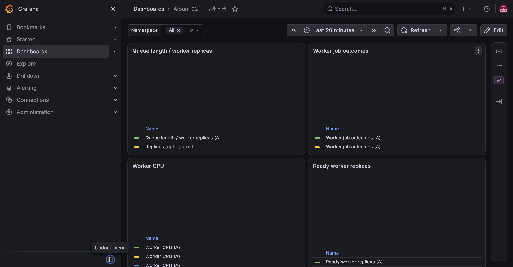

# E-03 큐 기반 worker 자동 확장

| 항목 | 내용 |
|---|---|
| 수행 일시 | 2026-10-15 09:07:07~09:15:52 KST |
| 환경 | dev K3S 단일 B4as_v2 노드 |
| 앱 버전 | 업로드·처리 dev-m3b, 냉각 대기 중 API만 dev-m6-v2로 교체 |
| 판정 | 통과 |

## 기대와 사전 상태

worker 0개에서 500장 업로드 시 0→N→0으로 변한다. 주 Redis list만
감시하고 processing list는 확장 기준에서 제외한다. dev 최대 2개,
목표 큐 길이 5, polling 5초, cooldown 300초다.

이전 동시 부하 실행은 500건 중 8건이 실패했고, 다음 재시도는 500건이
성공했지만 시작 시 worker 2개였다. 두 실행을 최종 0→N→0 증거로
취급하지 않았다. 데이터를 정리하고 worker 0개를 확인한 뒤 다시 실행했다.

## 수행 절차

ARTIFICIAL_DELAY_MS=500을 임시 적용했다. 생성 PNG는 1600×1200,
8,462 bytes이며 동시 업로드 8개, 총 500개다. ID 파일은 VM /tmp에만 둔다.

```bash
kubectl -n album-dev get deployment worker
uv run --python 3.13 loadtest/upload-batch.py
kubectl -n album-dev get hpa
uv run --python 3.13 loadtest/upload-batch.py --status
kubectl -n album-dev wait --for=jsonpath='{.spec.replicas}'=0 deployment/worker --timeout=180s
uv run --python 3.13 loadtest/upload-batch.py --cleanup
```

## 관찰

| 시각 KST | 실제 결과 |
|---|---|
| 09:07:07 | worker 0/0 |
| 09:07:10 | 500/500 업로드 성공 |
| 09:07:34 | worker 2/2, HPA 큐 표본 223.5/5 (Pod당 평균) |
| 09:09:51 | 주 큐 표본 0/5, worker 2/2로 냉각 대기 |
| 09:14:41 | worker 0/0 |
| 09:15:52 | DONE 500개 확인, 500개 fixture 삭제 완료 |



CPU Credits Remaining의 Azure 1분 Average 시계열을 보충했다. E-03 시작 직전
09:06 표본은 259.38, 종료 직후 09:16 표본은 267.80이었다. 구간 최저는
09:07의 257.83으로 고갈되지 않았다. 이 값은 VM 전체 크레딧이므로 앞선
E-02와 동시 VM 작업의 영향을 포함하며 E-03 단독 소비량으로 해석하지 않는다.

## 정리와 한계

ID로 식별한 사진만 삭제했고 임시 ID 파일도 제거했다. 저장소 설정은
ARTIFICIAL_DELAY_MS=0으로 복원했다. API 복구·롤링 실험을 냉각 대기 중
진행했지만 새 업로드는 하지 않아 worker 큐 활성 시각을 연장하지 않았다.
냉각은 마지막 활성 표본 기준이며 관찰 간격과 polling 때문에 정확히
벽시계 300초에 맞아떨어지지 않는다. 이 작은 압축 PNG 결과는 큰 실사진의
처리량을 보장하지 않는다.
