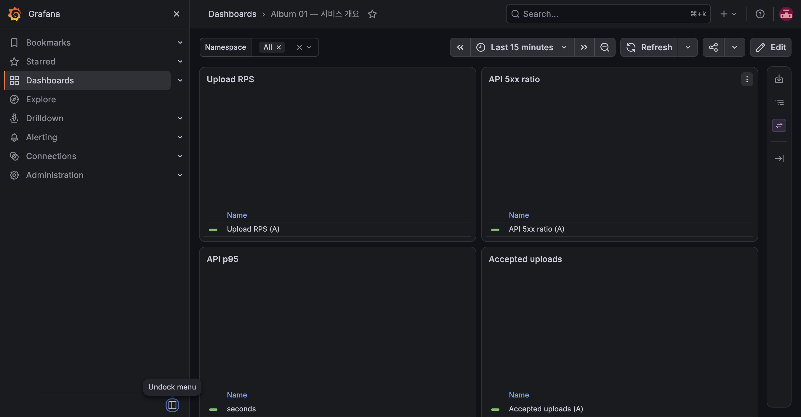

# E-04 무중단 롤링 업데이트

| 항목 | 내용 |
|---|---|
| 수행 일시 | 2026-10-15 09:13~09:23 KST |
| 환경 | dev 단일 노드, API 최소 2개 |
| 앱 버전 | v1=dev-m3b, v2=dev-m6-v2 |
| 판정 | 수정 후 통과 |

## 기대와 수행

maxUnavailable=0, maxSurge=1로 v1→v2를 교체하며 연속 조회의
X-App-Version과 X-Served-By를 기록한다.

```bash
uv run --python 3.13 scripts/observe-requests.py --duration 90
kubectl -n album-dev set image deployment/api api=ghcr.io/winty5959/album-api:dev-m6-v2
kubectl -n album-dev rollout status deployment/api --timeout=180s
```

## 실패와 수정

처음에는 236건 중 1건이 504였다. 이전 Pod 종료 구간에 시작한 요청이
30초 대기한 뒤 실패했다. Endpoint 변경이 Traefik에 반영되기 전에 Pod가
종료되는 구간을 줄이기 위해 preStop 10초, 종료 유예 45초를 추가했다.
이 원인은 관측에 근거한 설명이며 모든 504의 원인으로 일반화하지 않는다.

새 종료 설정으로 v1을 다시 배포한 뒤 v2로 교체했다. 09:21:14에
image 변경, 09:21:20에 rollout 완료를 확인했다. 90초 관측 결과:

```text
Requests=353 failures=0
dev-m3b: 27 successful responses
dev-m6-v2: 326 successful responses
HTTP 200: 353 / 353
```



## 정리와 한계

정상 v2를 유지한다. HPA 최소값은 운영 실험 종료 시 1로 복원한다.
작은 조회 요청의 단일 노드 관측 결과이며 장시간 streaming 요청이나
한 replica에서의 무중단 보장은 아니다.
