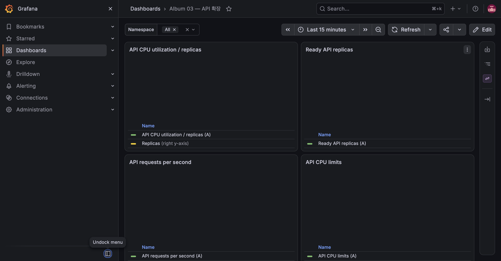

# E-05 잘못된 readiness와 rollout 중단

| 항목 | 내용 |
|---|---|
| 수행 일시 | 2026-10-15 09:24:50~09:26 KST |
| 환경 | dev, API 최소 2개 |
| 앱 버전 | 정상 dev-m6-v2, 시험 dev-m6-v3-bad |
| 판정 | 통과 |

## 기대와 사전 상태

maxUnavailable=0에서 새 Pod readiness가 실패하면 이전 Pod가 유지되고
rollout이 중단된다. v3는 정상 v2 이미지에 APP_VERSION override와 존재하지
않는 `/intentionally-not-ready` probe 경로를 적용했다. probe는 404이므로
Kubernetes readiness는 실패한다. liveness 경로는 바꾸지 않았다.

## 실제 절차와 결과

1. 120초 연속 조회 관측을 시작했다.
2. v3 설정과 progressDeadlineSeconds=60을 한 번의 strategic patch로 적용했다.
3. 09:25:51에 Deployment Progressing 사유가 ProgressDeadlineExceeded였다.
4. 새 ReplicaSet은 desired/current 1, ready 0. 기존 v2는 2/2 Ready였다.
5. `kubectl rollout undo deployment/api` 후 정상 v2 rollout이 완료됐다.
6. progressDeadlineSeconds를 운영값 180으로 복원했다.

```text
Requests=471 failures=0
New bad ReplicaSet: 1 current, 0 ready
Old v2 ReplicaSet: 2 current, 2 ready
```



## 정리와 한계

APP_VERSION override와 잘못된 readiness 경로는 undo로 제거됐다.
이 시험은 ArgoCD 도입 전 수동 배포 단계에서 실행했다. kubectl undo는
last-applied annotation을 수정하지 않으므로 후속 정상 Git overlay apply로
선언된 기준 상태를 다시 맞춘다. GitOps 도입 뒤의 rollback은 E-14에서 다룬다.
