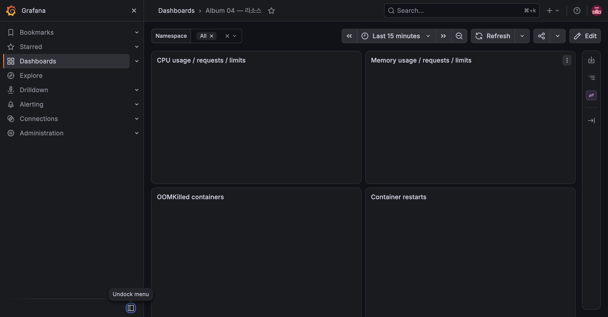

# E-06 OOMKilled와 작업 재시도

| 항목 | 내용 |
|---|---|
| 수행 일시 | 2026-10-15 09:29~09:32 KST |
| 환경 | dev, worker 1개로 KEDA 일시 정지 |
| worker 버전 | dev-m7-base (Python 3.13 Alpine 이미지) |
| 판정 | 통과 |

## 기대와 수행

메모리 limit 64Mi, request 32Mi로 바꾸고 기존 worker가 완전히 종료된 뒤
9000×9000 PNG 한 장을 업로드했다. 파일은 258,637 bytes로 API 10MiB 제한
이하다. 픽셀 수는 Pillow의 기본 decompression-bomb 오류 기준 이하여서
검증 오류가 아닌 실제 decode 메모리 사용으로 OOM을 유발한다.

```bash
kubectl -n album-dev annotate scaledobject worker autoscaling.keda.sh/paused-replicas=1
uv run --python 3.13 loadtest/upload-batch.py --count 1 --concurrency 1 \
  --width 9000 --height 9000 --output /tmp/album-e06-id.json
uv run --python 3.13 loadtest/upload-batch.py --status --expect FAILED \
  --output /tmp/album-e06-id.json
```

## 관찰

동일 Pod에서 restartCount가 0→1→2→3으로 늘었고 마지막 종료 원인은
OOMKilled였다. 재시작한 worker가 자신의 processing list를 복구했다.
최종 사진 상태는 FAILED, retry_count=3이었다. 재시도 한도가 무한 루프를 막았다.



## 정리와 후속 수정

request 128Mi / limit 512Mi로 복원했고 시험 사진과 ID 파일을 삭제했다.
KEDA pause annotation도 제거했다. 원래 설정을 복원하는 동안 이전 worker가
SIGTERM 이후 BLMOVE에서 새 작업을 받는 경합이 별도 smoke에서 드러났다.
미처리 항목을 원래 큐로 LMOVE하여 돌려주도록 수정했고 회귀 테스트가 통과했다.
수정 이미지로 전체 업로드→DONE→썸네일→원본→삭제 smoke가 다시 통과했다.

## 한계

실제 사진 1장의 실패 경로를 관찰했다. 이 결과는 어떤 작업이든 64Mi에서
동작한다는 의미가 아니다. 이전 Pod가 영구 삭제된 작업은 container restart
복구가 아니라 lease cleanup으로 회복하므로 복구 시간이 더 길 수 있다.
