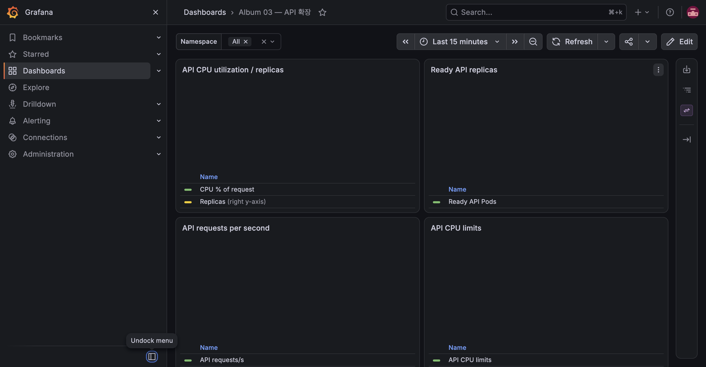

# E-07: liveness와 readiness 분리

## M6 수용 기준 재검증

| 항목 | 내용 |
|---|---|
| 수행 일시 | 2026-10-15 09:41:14~09:41:53 KST |
| 환경 / 버전 | dev 단일 노드, dev-m7-base |
| 판정 | 통과 |

PostgreSQL 1→0 후 Pod 삭제와 API Ready=false를 확인했다. Pod 내부
healthz는 200, readyz는 503이었다. PostgreSQL을 1로 복원한 뒤 StatefulSet과
API Ready가 자동 회복됐다. API Pod UID와 restartCount가 전후 동일했다.
EXIT trap도 PostgreSQL replica를 1로 복원하도록 두었다.

이 장애는 singleton DB의 일시적인 서비스 중단을 유발한다. 데이터 서비스
장애를 API liveness 실패로 연결하지 않는다는 것을 검증했다.

## M3 사전 검증

실행일: 2026-10-15. 환경: dev K3S, dev-m3.

## 절차와 관측

1. API Pod restartCount를 기록하고 PostgreSQL StatefulSet을 0 replica로 축소했다.
2. PostgreSQL Pod 삭제와 API `Ready=false`를 기다렸다.
3. API Pod 내부 HTTP 요청: `/healthz` 200, `/readyz` 503.
4. API Service EndpointSlice에 ready endpoint가 없는 것을 확인했다.
5. PostgreSQL을 1 replica로 복구하고 API Ready를 기다렸다.
6. API restartCount가 변경되지 않았고 전체 앨범 smoke가 통과했다.

결과: **통과**. 의존 서비스 장애는 API 재시작을 유발하지 않고 트래픽 수신만 중단한다.
테스트 셸의 EXIT trap으로 PostgreSQL replica를 항상 1로 복구했다.

worker readiness는 dependency 검사가 아니라 주 루프 heartbeat다. worker는 HTTP
트래픽을 받지 않고 Redis 소비를 직접 재시도하므로 dependency 실패를 liveness에
연결하지 않는다. 주 루프가 120초 이상 멈추면 health가 실패한다.
