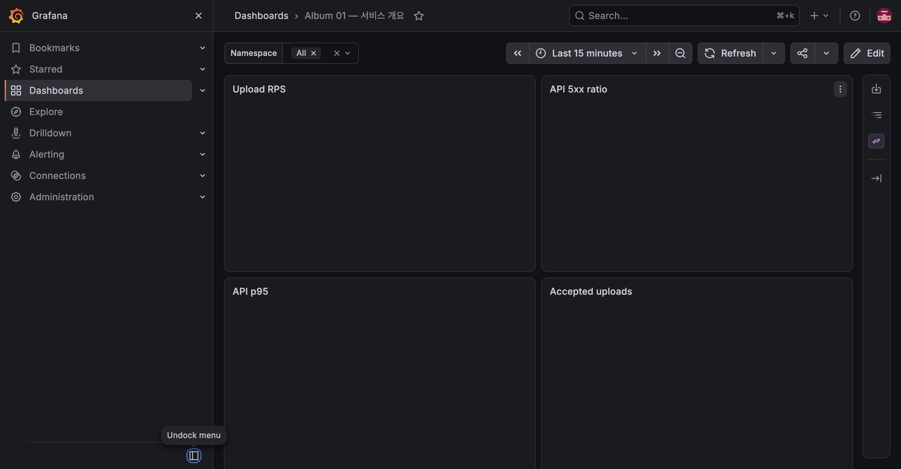

# E-08: StatefulSet 데이터 유지와 작업 회수

## M6 수용 기준 재검증

| 항목 | 내용 |
|---|---|
| 수행 일시 | 2026-10-15 09:45:11~09:45:25 KST |
| 환경 | dev 단일 노드, local-path PVC |
| 버전 | API dev-m7-base, worker dev-m7-stop |
| 판정 | 통과 |

```bash
uv run --python 3.13 scripts/check-persistence.py
```

원본과 DONE 사진을 만든 뒤 PostgreSQL·Redis·MinIO Pod를 모두 삭제했다.
재생성 후 DB 상태·processed_by, 원본 bytes, 200×100·800×400 썸네일을
확인했다. 시험 사진과 임시 ID 파일은 삭제했다.

처음 재실행은 dependency Pod Ready 직후 일시적인 HTTP 500과 cleanup의
502 때문에 실패했다. 이전 fixture 1개만 삭제하고, API의 실제 접근 복구를
최대 60초 기다리도록 보완했다. 404 등 데이터 손실 응답은 재시도하지 않는다.
후속 실행은 모든 비교가 통과했다. 이 실험은 singleton DB 교체 시 무중단을
보장하는 실험이 아니라 데이터 영속성 검증이다.



## M3 사전 검증

실행일: 2026-10-15. 환경: dev K3S, dev-m3, local-path PVC.

## 재현

```bash
scripts/sync.sh dev
ssh kube-dev 'cd ~/kube-study && python3 scripts/check-persistence.py'
ssh kube-dev 'kubectl -n album-dev exec -i deployment/api -- python -' \
  < apps/api/tests/cleanup_scenarios.py
```

## 관측

- 테스트 사진을 업로드해 DONE을 기다린 뒤 postgres-0, redis-0, minio-0을 삭제했다.
- 각 StatefulSet rollout과 API Ready를 기다렸다.
- DB 상태와 processed_by가 유지됐고 원본 bytes가 동일했다.
- 썸네일은 200×100, 800×400 WebP로 유지됐다. 테스트 사진은 끝에 삭제했다.
- cleanup 회귀 검증은 별도 schema·queue·bucket에서 수행했다.
  만료 PROCESSING 재등록, 활성 PROCESSING 보호, 3회 실패 종료, 누락 PENDING
  enqueue, 고아 객체 삭제/참조 객체 유지, cleanup 재실행 멱등성이 모두 통과했다.

결과: **통과**. PVC는 Pod 재생성 시 데이터와 큐를 보존한다.
node 자체나 디스크가 손실되는 경우의 복구는 이 실험 범위에 포함되지 않는다.
local-path는 단일 노드 스토리지이며 노드 장애에 대한 복제 기능이 없다.
