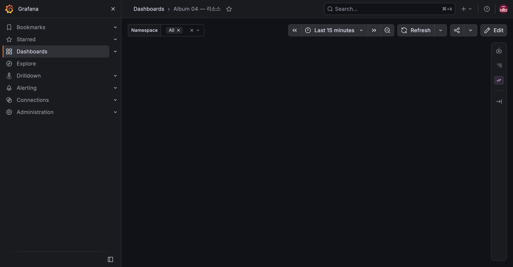

# E-09 NetworkPolicy 통신 제어

| 항목 | 내용 |
|---|---|
| 수행 일시 | 2026-10-15 09:11 KST |
| 환경 | dev, K3S 단일 노드 |
| 앱 버전 | dev-m3b |
| 판정 | 통과 |

## 목적과 기대

기본 ingress/egress 차단 후 필요한 경로만 허용한다. frontend는 PostgreSQL에
연결할 수 없고 API·worker·migrate·cleanup만 데이터 서비스에 접근한다.
브라우저가 Ingress로 API와 S3에 접근하므로 frontend에서 API로 나가는
별도 경로는 필요하지 않다. DNS, Prometheus scrape, KEDA→Redis도 허용한다.

## 실제 절차

정책 적용 전 frontend에서 `nc -z -w 3 postgres 5432`가 종료 코드 0이었다.

```bash
kubectl -n album-dev apply -f k8s/base/network-policies.yaml
kubectl -n album-dev exec deploy/frontend -- nc -z -w 3 postgres 5432
kubectl -n album-dev exec deploy/frontend -- sh -c 'getent hosts postgres >/dev/null'
kubectl -n album-dev exec deploy/api -- python -c \
  'import socket; socket.create_connection(("postgres",5432),timeout=3).close()'
curl --fail --silent 'http://album.dev.local/api/photos?size=1' >/dev/null
```

## 관찰

frontend TCP 연결은 종료 코드 1, DNS 해석은 성공했다. API의 새 TCP 연결은
성공했고 Ingress 조회도 HTTP 200이었다. DNS 장애로 인한 오판을 제외했다.

## 정리와 한계

정책은 제품 운영 구성으로 유지하며 base Kustomization에도 포함했다.
이 정책은 인증·인가를 대체하지 않는다. 단일 노드 내부에서 Pod 간 통신을
검증했으며 host-network 프로세스나 노드 자체의 공격 차단은 주장하지 않는다.
적용 후 `check-observability.py dev`도 종료 코드 0으로 완료됐다.
5개 대시보드 20개 패널의 모든 쿼리에서 실제 표본이 유지됐고 알림 3개가 등록돼 있었다.


