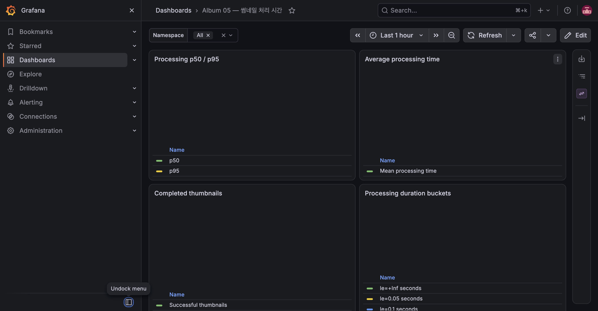

# E-10 ConfigMap 변경과 롤아웃

| 항목 | 내용 |
|---|---|
| 수행 일시 | 2026-10-15 09:48:40~09:48:49 KST |
| 환경 | dev, K3S 단일 노드 |
| 판정 | 통과 |

## 절차와 관찰

worker를 일시적으로 1개 유지하고 dev configMapGenerator에
`THUMB_SMALL_PX=120`, `THUMB_MEDIUM_PX=480`을 설정했다.
`kubectl apply -k k8s/overlays/dev` 후 ConfigMap 이름은
`album-config-d9mf45f292`에서 `album-config-dgthbdgb9c`로 바뀌었다.
Pod template의 참조도 변경되어 API와 worker 롤아웃이 완료됐다.

1200×600 PNG 한 장(3,462 bytes)을 업로드했다. DONE 상태에서 실제 WebP
파일을 읽어 작은 썸네일 120×60, 중간 썸네일 480×240을 확인했다.
기존 파일은 재생성하지 않으므로 변경 후 업로드한 사진으로 검증했다.

## 정리

fixture를 삭제하고 임시 설정을 제거했다. 원래 ConfigMap 해시로 복구된 뒤
API·worker 롤아웃 완료를 기다렸고 KEDA 일시 정지 설정을 해제했다.
전체 smoke를 다시 실행해 기본 크기 200×100·800×400과 업로드·조회·삭제가
정상임을 확인했다. ConfigMap 변경만으로 환경 변수를 읽는 기존 프로세스가
즉시 갱신되는 것은 아니며, 해시가 포함된 참조 변경이 롤아웃을 유발한다.

