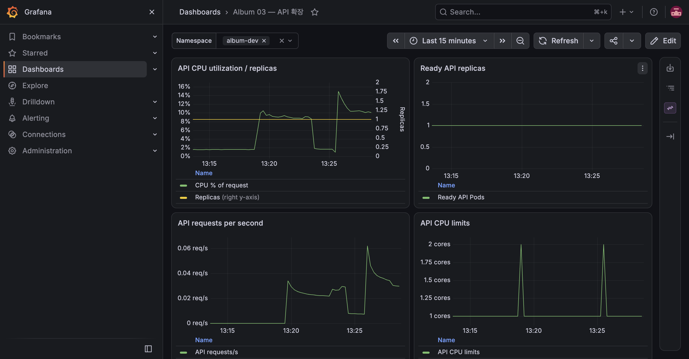

# E-11 GitOps 자동 배포

| 항목 | 내용 |
|---|---|
| 수행 일시 | 2026-10-15 13:20:25~13:25:43 KST |
| 환경 | dev, 단일 노드 K3S |
| 앱 버전 | sha-a3e8669 → sha-f141475 |
| 판정 | 통과 |

## 목적과 기대 결과 (PRD 원문)

별도 조작 없이 수 분 안에 dev에 새 Pod가 뜨고 `X-App-Version`이 새 sha로 바뀜.

## 사전 상태

CI의 네 이미지 빌드·검사·공개 push가 모두 성공했고, dev 자동 Sync가 적용돼 있었다.
MinIO 예외는 사용자 승인에 따라 해당 binary의 6건만 2026-11-14까지 적용했다.
기존 API Pod는 `api-6544954c6f-nqlk2`, 버전은 `sha-a3e8669`였다.

## 수행 절차

API의 FastAPI 생성 한 줄에 `description="Photo album API."`를 추가했다.
VM에서 API ruff와 pytest 12개가 통과한 뒤 커밋 `f141475`를 main에 push했다.
이후 Actions·Git 이력·HTTP 헤더·Application 상태를 조회만 했으며,
`kubectl apply`, 이미지 import, ArgoCD refresh·수동 Sync는 사용하지 않았다.

## 관찰 결과

| 시각 (KST) | 관찰 |
|---|---|
| 13:20:25 | main push, 코드 커밋 f141475 |
| 13:20:29 | [CI 38680948685](https://github.com/winty5959/kube-study/actions/runs/38680948685) 생성 |
| 13:21:55 | 네 컴포넌트별 bot 승격 커밋 생성, 마지막 efb70fa |
| 13:22:00 | CI 전체 성공 |
| 13:25:00 | ArgoCD 자동 Sync 시작 |
| 13:25:31 | 새 Pod api-85894d99cf-f5kct의 HTTP 200, X-App-Version sha-f141475 확인 |
| 13:25:43 | Sync 완료, PreSync migration·PostSync smoke 모두 Succeeded |

최종 Application은 Synced·Healthy·Succeeded였다. push부터 완료까지 5분 18초다.
기본 감지 주기와 rolling update·훅 실행 시간이 포함된다.

## 기대 결과와 정리

새 Pod와 새 sha 헤더가 자동 반영됐으므로 기대 결과와 일치했다. bot 커밋은
dev overlay만 변경해 CI를 다시 유발하지 않았다. API 설명은 유효한 제품 변경으로
유지하고, smoke가 생성한 사진은 해당 실행 안에서 삭제했다.

## 한계

단일 노드와 해당 시점의 GitHub 러너·registry·ArgoCD 감지 조건에 대한 결과다.
다른 실행의 배포 시간을 보장하지 않는다. 상태 조회는 배포 조작과 구분한다.
