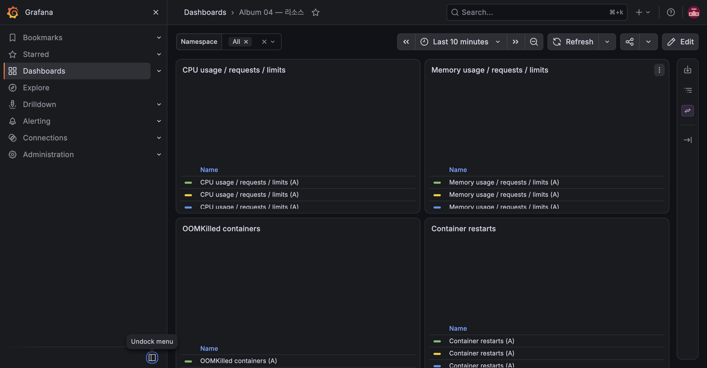

# E-12 GitOps replica 자동 복구

| 항목 | 내용 |
|---|---|
| 수행 일시 | 2026-10-15 10:17:16~10:17:18 KST |
| 환경 | dev, ArgoCD 자동 Sync·selfHeal |
| 판정 | 통과 |

Git의 frontend replica는 2다. `kubectl -n album-dev scale deployment/frontend
--replicas=5`로 실제 spec을 변경했다. 직후 desired=5, ready=2였고, 1초 표본도
5:2였다. 다음 표본은 2:2로 되돌아왔다. 변경부터 관찰 종료까지 약 2초였다.

album-dev Application은 Synced·Healthy, operation Succeeded였다. 별도 Git
수정이나 수동 Sync 없이 selfHeal이 Git의 replica 값으로 복구했다.
5개 Pod가 모두 Ready가 됐다는 주장은 하지 않는다. 자동 복구가 먼저 실행됐다.

실험 후 replica 2와 정상 Application 상태를 유지한다. HPA·KEDA가 소유한
API·worker replica는 Git에 고정하지 않고, frontend의 고정 replica로 검증했다.

