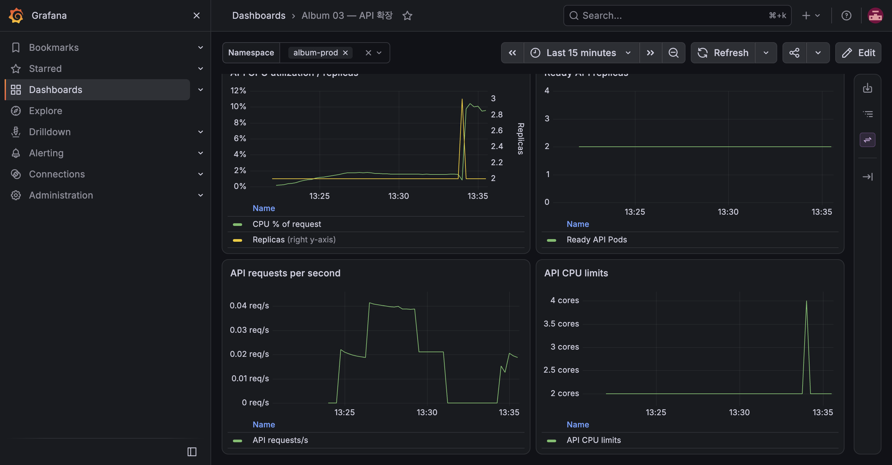

# E-13 운영 승격

| 항목 | 내용 |
|---|---|
| 수행 일시 | 2026-10-15 13:27~13:36 KST |
| 환경 | dev·prod, 독립 단일 노드 K3S |
| 앱 버전 | dev sha-f141475, prod sha-a3e8669 → sha-f141475 |
| 판정 | 통과 |

## 목적과 기대 결과 (PRD 원문)

prod 이미지 digest가 dev와 같은지 `kubectl get pod -o jsonpath`로 확인.

## 사전 상태

E-11이 완료됐고 dev의 네 CI 이미지 태그는 sha-f141475였다. prod는 세 명령
bootstrap으로 sha-a3e8669를 제공했고, 앱의 자동 Sync는 꺼져 있었다.

## 수행 절차

1. main에 `git tag v1.1.0` 후 tag push.
2. [Release 38681497959](https://github.com/winty5959/kube-study/actions/runs/38681497959)가
   기존 manifest를 alias로 등록하고 네 컴포넌트별 커밋으로 [PR #1](https://github.com/winty5959/kube-study/pull/1) 생성.
3. 별도 VM 익명 registry 접근으로 dev·release raw manifest가 바이트 단위로 같음을 확인.
4. 사용자 운영 승인 후 13:33:03에 PR merge (64cdcd1).
5. prod 앱은 OutOfSync·Healthy 상태에서 기존 sha-a3e8669를 계속 제공함을 확인.
6. ArgoCD CLI로 prod 수동 Sync. 배포 경로에 `kubectl apply`나 직접 이미지 변경은 없었다.
7. migration·PostSync 성공과 전체 smoke 후 두 클러스터의 실제 Pod imageID를 조회.

## 관찰 결과

| 컴포넌트 | dev·prod에서 일치한 manifest digest |
|---|---|
| API | sha256:644650e7092e53d7171d08d6cf8829d0ed609a2f382966c9f2cf9acdb647cc52 |
| worker | sha256:e960d73c97f3a116be4c6a7535ed45ff4b69ce93f03cdad5be7edea1183225df |
| frontend | sha256:572bc01fcd3a2d536a223486b3dc384d72e08df78616af1b7e29e9f0fba17284 |
| MinIO | sha256:d04ce6a94325ec08181157c7a554f0397ece516f60e91901b862cf3302a0890c |

prod Deployment·StatefulSet template의 네 이미지 태그는 모두 v1.1.0이었다.
동일 digest의 runtime 캐시는 일부 `.status.containerStatuses[].image`에 이전 sha
태그를 반환했으므로 선언된 template 태그와 imageID를 함께 확인했다. worker는
dev에서 새 smoke를 실행해 실제 Pod를 띄운 후 비교했다.

최종 앱은 Synced·Healthy·Succeeded, API 2 Ready였고 버전 헤더는 sha-f141475였다.
공개 라우팅의 업로드·두 썸네일 크기·원본 바이트 일치·삭제도 통과했다.

## 기대 결과와 정리

네 imageID 일치로 재빌드 없는 승격을 확인했다. 초기 bootstrap의 일회성 Sync
요청도 Release PR merge 후 새 배포를 자동 실행하지 않았다. release alias와
승격 이력은 유지하고 E-14 롤백 실험으로 이어갔다. smoke 사진은 실행에서 삭제했다.

## 한계

이 검증은 amd64 단일 플랫폼 manifest 승격이다. 다중 플랫폼 index 승격과
장애가 발생한 registry에서의 동작을 검증하지 않았다.
