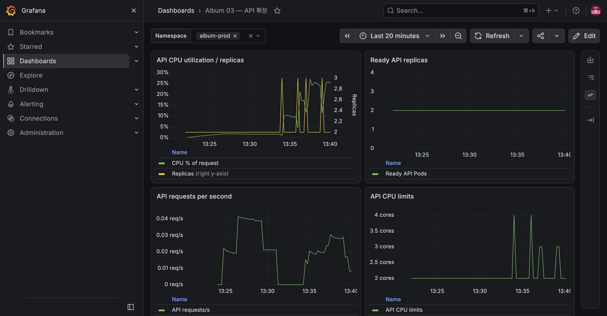

# E-14 GitOps 롤백

| 항목 | 내용 |
|---|---|
| 수행 일시 | 2026-10-15 13:35~13:40 KST |
| 환경 | prod |
| 앱 버전 | sha-f141475 → sha-a3e8669 → sha-f141475 → sha-a3e8669 |
| 판정 | 통과 (수동 Sync 정책에서의 복구 시점 명시) |

## 목적과 기대 결과 (PRD 원문)

앞의 방법은 ArgoCD가 덮어쓰고, 뒤의 방법은 Git 이력이 남은 채로 롤백됨.

## 사전 상태와 정책

E-13으로 v1.1.0이 배포됐고 API 2개가 새 sha-f141475를 제공했다.
PRD의 prod 수동 Sync·selfHeal 병기는 ArgoCD의 automated.selfHeal 구조와
양립하지 않는다. 운영 승인 원칙을 유지하기 위해 순수 수동 Sync를 선택했다.
따라서 live undo는 자동 복구되지 않고 **다음 수동 Sync가** Git으로 덮어쓴다.
실험의 kubectl undo는 PRD가 명시한 의도된 개입이며 정상 배포 경로가 아니다.

## 수행 절차와 관찰

1. VM에서 `kubectl -n album-prod rollout undo deployment/api` 실행,
   `rollout status --timeout=120s` 성공.
2. 13:36:12에 이전 sha-a3e8669 헤더와 OutOfSync·Healthy를 확인.
   13:36:48에도 같은 상태였다. Git의 v1.1.0 선언은 바뀌지 않았다.
3. ArgoCD CLI 수동 Sync를 실행했다. live undo가 덮어써져 sha-f141475를
   다시 제공했고 최종 Synced·Healthy가 됐다.
4. 실제 `git revert --no-commit`으로 Release의 네 컴포넌트 커밋을 되돌리고
   각각 독립 커밋으로 남겼다. 14512f0(MinIO), eeb4032(frontend),
   94a137a(worker), 776ca4b(API)가 원래 승격 커밋의 Related trailer를 보존한다.
5. main push 후 prod는 다시 OutOfSync·Healthy가 됐다. ArgoCD CLI 수동 Sync를 실행.
6. sha-a3e8669가 제공됐고 migration·PostSync 모두 Succeeded,
   Application Synced·Healthy·Succeeded를 확인했다. smoke 사진 수는 최종 0이었다.

## 기대 결과와 비교

| 기대 | 실제 |
|---|---|
| rollout undo를 ArgoCD가 덮어씀 | 수동 Sync가 Git의 v1.1.0으로 복구함. 자동 selfHeal로 복구됐다고 주장하지 않음 |
| git revert 이력과 함께 롤백 | 네 revert 커밋이 main에 남고, Sync 이후 Git·live 모두 sha-a3e8669 |

## 정리와 한계

정식 롤백 상태를 유지했다. dev는 sha-f141475, prod는 이전 검증 이미지
sha-a3e8669이며 이 차이는 의도된 Git 상태다. 다음 빈 OS 재현도 이 선언을 복원한다.
release alias와 PR 이력은 삭제하지 않았다. 자동 prod selfHeal 동작이나
ArgoCD History → Rollback은 이번 실험에서 실행하지 않았다.
