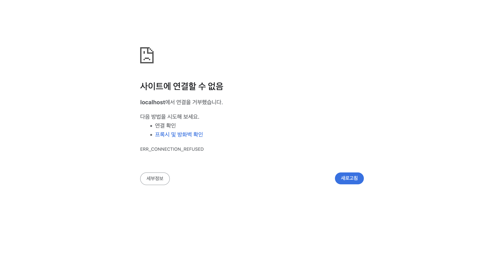

# E-15 PreSync 마이그레이션 실패 게이트

| 항목 | 내용 |
|---|---|
| 수행 일시 | 2026-10-15 10:19~10:24 KST |
| 환경 | dev, ArgoCD 자동 Sync |
| 판정 | 통과 |

`003_e15_invalid.sql`에 문법 오류를 넣은 API 이미지 `dev-m8-invalid`를
VM에서 빌드·import하고 실험 커밋 `5a3f4cd`를 push했다. 실험 동안 migration
Job은 backoff 0·deadline 60초로 제한했다. 기존 API는 `dev-m7-base`였다.

PreSync db-migrate는 다음 실제 PostgreSQL 오류로 실패했다.

```text
psycopg.errors.SyntaxError: syntax error at or near "THIS"
LINE 2: THIS IS INTENTIONALLY INVALID SQL;
```

ArgoCD는 3회 재시도 후 operation Failed를 기록했다. Sync 단계에 도달하지
못해 API Deployment 이미지가 그대로 유지됐다. 10:19:26~10:20:55 KST의
90초 관찰은 351회 모두 HTTP 200이고 X-App-Version은 모두 dev-m7-base였다.
새 앱 배포 실패와 기존 서비스 가용성을 별도로 확인했다.

## 진단 보완과 정리

OnFailure Pod가 job backoff 0에서 삭제돼 최초 SQL 로그가 남지 않았다.
Job의 restartPolicy를 Never로 보완한 커밋 `087bb9c` 이후 재실행해 실패한
Pod와 SQL 로그를 보존했다. 제품 기본 Job은 backoff 6을 유지한다.

실험 커밋을 `git revert`해 잘못된 SQL과 이미지 태그, 임시 Job 제한을 제거했다.
진단을 위한 Never 설정은 유지한다. 복구 후 성공한 PreSync/PostSync와 API
가용성, 미적용 migration 버전을 이어서 확인한다.

Git revert 후 실제 Deployment는 이미 기존 버전과 같아 자동 Sync를 다시 시작하지 않았다. ArgoCD에서 수동 Sync를 한 번 요청해 정상 PreSync·PostSync와 Synced·Healthy·Succeeded 복구를 확인했다. DB schema_migrations에 `003_e15_invalid` 기록이 0건임을 확인했다.


